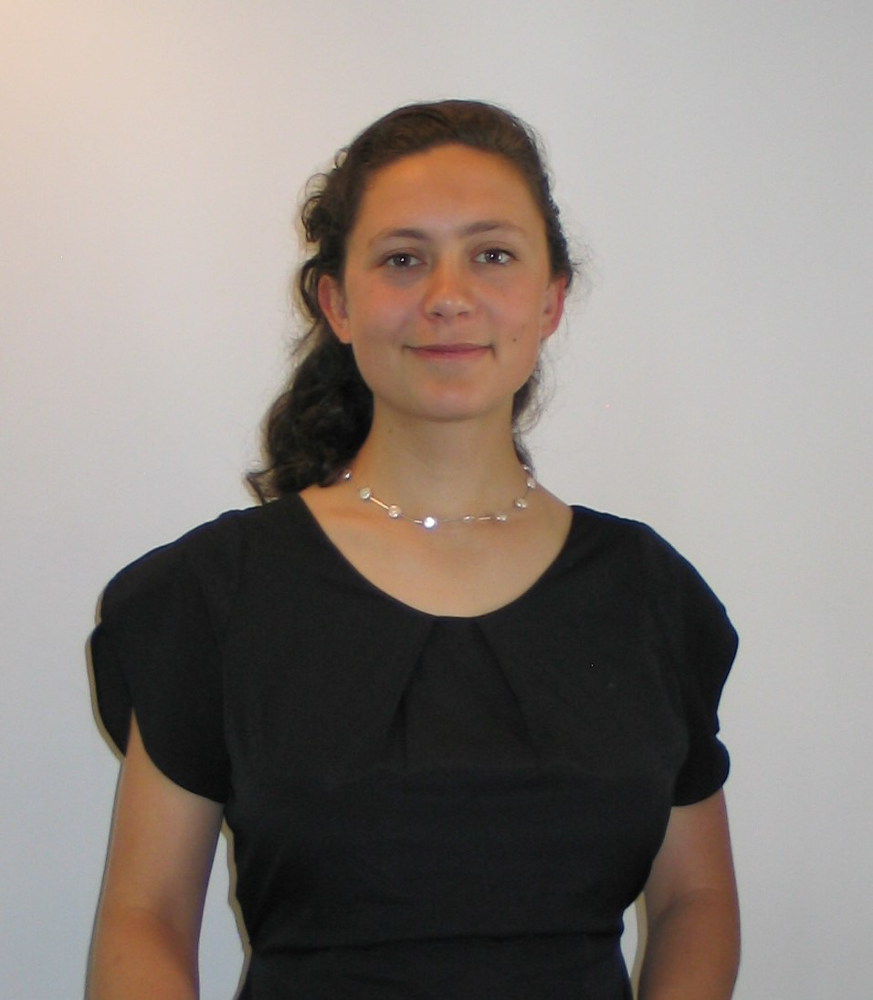

```{=html}
<div class="hero" style="display:flex; flex-direction:row; align-items:flex-start; gap:2rem; margin:2rem 0;">

  <div class="hero-left" style="flex:0 0 260px; text-align:center; background:transparent; border:none; box-shadow:none; padding:0; margin:0;">
    
    <div class="job">PhD Candidate in Economics</div>
    <div class="affiliations">
      <a href="https://www.telecom-paris.fr/" target="_blank">Télécom Paris</a>
      <a href="https://www.ip.mpg.de/en/" target="_blank">Max Planck Institute for Innovation and Competition</a>
    </div>
    <br>
    <div class="bubbles">
      <a class="bubble" href="https://github.com/margueritedelatullaye" title="GitHub"><i class="bi bi-github"></i></a>
      <a class="bubble" href="mailto:marguerite.delatullaye@gmail.com" title="Mail"><i class="bi bi-envelope-fill"></i></a>
      <a class="bubble" href="https://www.linkedin.com/in/marguerite-de-la-tullaye-010487249/" title="LinkedIn"><i class="bi bi-linkedin"></i></a>
    </div>
  </div>

<div class="col-md-8">
  <p class="hero-text">I am a first year PhD student exploring subjects at the intersection of innovation economics and public policies. 
  I work at both <a href="https://www.telecom-paris.fr/">Télécom Paris</a> (affiliated with CREST), and the <a href="https://www.ip.mpg.de/en/">Max Planck Institute for Innovation and Competition</a>. My thesis supervisor is <a href="https://sites.google.com/view/laurieciaramella">Laurie Ciaramella</a> with <a href="https://sites.google.com/site/clementmalgouyres/">Clément Malgouyres</a> and <a href="https://www.ip.mpg.de/en/persons/prof-dietmar-harhoff">Dietmar Harhoff</a>.
  I am going to empirical methods on newly available CASD data to unfold : 
  <ul>
  <li><p class="hero-text">the impact of a labor cost reduction on start-up performance</p></li>
  <li><p class="hero-text">the value of Intellectual Property and R&D assets transferred by companies when companies try to maximise their profits over assets location.</p></li>
  </ul>

  <p class="hero-text">Feel free to get in touch.</p>
  </p>
</div>

</div>
```

## BACK IN TIME {.unnumbered}


Before, I was a research assistant at INRAE (National Institute for the Environment, Agriculture, and ), part of the Center . 
There I first 

## CONTACT {.unnumbered}

Votre adresse, votre mail, etc.